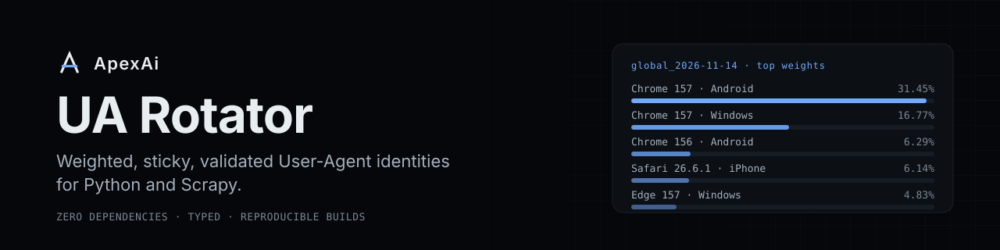
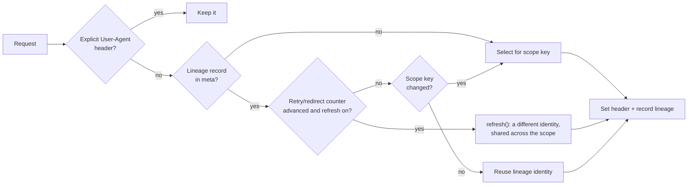
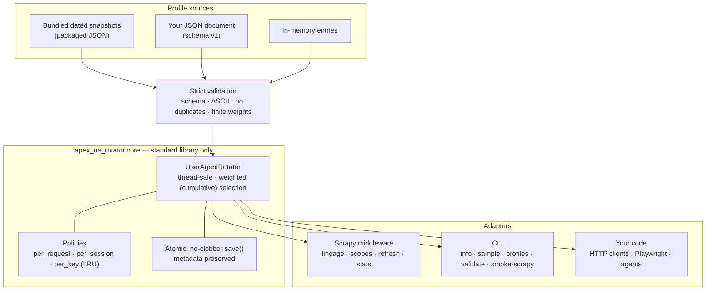

<div align="center">

<a href="https://github.com/ApexAiOfficial/ua-rotator">
  <picture>
    <source media="(prefers-color-scheme: dark)" srcset="docs/assets/banner-dark.svg">
    <source media="(prefers-color-scheme: light)" srcset="docs/assets/banner-light.svg">
    
  </picture>
</a>

<br>

[](https://github.com/ApexAiOfficial/ua-rotator/actions/workflows/ci.yml)
[](https://github.com/ApexAiOfficial/ua-rotator/releases/latest)
[](#installation)
[](#scrapy-integration)
[](#why-ua-rotator)
[](pyproject.toml)
[](docs/VALIDATION.md#verifying-a-published-release)
[](#license)

**[Install](#installation)** · **[Quick start](#quick-start)** · **[Scrapy](#scrapy-integration)** · **[Docs](#documentation)** · **[Releases](https://github.com/ApexAiOfficial/ua-rotator/releases)**

</div>

---

**UA Rotator** picks a realistic browser User-Agent for every request, from a dated and validated profile weighted by real-world browser share. It can keep that identity consistent per request, per crawl, or per domain, account, cookie jar, or proxy. The core is a single dependency-free Python module. An optional Scrapy middleware carries the identity across retries and redirects and replaces it only when you ask.

```python
from apex_ua_rotator import UserAgentRotator

rotator = UserAgentRotator.from_bundled_profile(policy="per_key")
rotator.select(key="example.com")   # same value for example.com on every call, e.g.
# 'Mozilla/5.0 (Windows NT 10.0; Win64; x64) AppleWebKit/537.36 (KHTML, like Gecko) Chrome/157.0.0.0 Safari/537.36'
```

## Why UA Rotator

| | |
|---|---|
| ⚖️ **Weighted by real usage** | The bundled profile models global desktop, mobile, and tablet browser share: 85 internally consistent strings across Chrome, Safari, Edge, Firefox, and Opera on desktop, Android, and iOS, with weights totaling exactly 100. |
| 🧷 **Sticky identities** | One identity per request, per process, or per any key you choose: domain, account, cookie jar, proxy. A bounded LRU cache keeps memory flat on large crawls. |
| 🔁 **Refresh that actually changes** | `refresh()` replaces a blocked identity with a *different* one, and concurrent failures in one scope converge on a single replacement instead of churning. |
| 🕷️ **Scrapy-native** | The downloader middleware follows Scrapy's request lineage through retries and redirects. It has five scopes, explicit refresh rules, and full stats, and it is tested against Scrapy 2.11 and the latest 2.x. |
| 🛡️ **Strict by default** | Malformed, duplicated, ambiguous, or header-unsafe input is rejected at load time, never at request time. Saves never expose a partially written file and never overwrite one unless asked. |
| 🎯 **Accurate profiles** | Chromium entries use the reduced User-Agent format and Chrome's frozen platform tokens. A token-level lint in CI catches inconsistent strings before they ship. |
| 📦 **Zero dependencies, fully typed** | The core uses only the standard library and passes `mypy --strict`. Scrapy stays optional. |
| 🔏 **Verifiable releases** | Every release artifact is byte-for-byte reproducible from its tag, published with `SHA256SUMS`, and re-verified on GitHub's infrastructure. |

## Installation

UA Rotator is distributed through [GitHub Releases](https://github.com/ApexAiOfficial/ua-rotator/releases); it is not published on PyPI. Python 3.10 or newer is required.

| Option | Best for |
|---|---|
| **Wheel** from the latest release | Most projects; works with any pip-based tooling |
| **One-file installer** (`.pyz`) | Phones (Pydroid 3, Termux) and machines without Git: one file installs, verifies, and smoke-tests |
| **Offline bundle** (`.zip`) | Air-gapped installs: wheel, sdist, installer, launchers, profiles, docs, and checksums in one archive |
| **From source** | Development and auditing |

**Wheel (pip):**

```bash
python -m pip install "https://github.com/ApexAiOfficial/ua-rotator/releases/download/v1.4.0/apex_ua_rotator-1.4.0-py3-none-any.whl"

# with the optional Scrapy dependency
python -m pip install "apex-ua-rotator[scrapy] @ https://github.com/ApexAiOfficial/ua-rotator/releases/download/v1.4.0/apex_ua_rotator-1.4.0-py3-none-any.whl"
```

**One-file installer:** download `apex-ua-rotator-1.4.0-one-shot.pyz` from the release, then run:

```bash
python3 apex-ua-rotator-1.4.0-one-shot.pyz                  # install, verify, smoke-test Scrapy if present
python3 apex-ua-rotator-1.4.0-one-shot.pyz --install-only
python3 apex-ua-rotator-1.4.0-one-shot.pyz --verify-payload # check the embedded wheel only
```

The installer checks the embedded wheel's SHA-256 before installing and verifies the result in a fresh interpreter. If you don't know where the file was saved, the [phone and computer locators](launchers/README.md) find the newest valid copy, print its checksum, and run exactly the bytes they checked (`--expect-sha256` pins a release).

**From source:**

```bash
git clone https://github.com/ApexAiOfficial/ua-rotator.git
cd ua-rotator
python -m pip install ".[scrapy]"     # or "." for the core only
```

**Verify a download** against the release's checksums:

```bash
sha256sum --check --ignore-missing SHA256SUMS
```

## Quick start

```python
from apex_ua_rotator import UserAgentRotator

# The bundled, dated global profile; no data file needed.
rotator = UserAgentRotator.from_bundled_profile()
rotator.select()                     # weighted pick on every call
rotator.metadata["as_of"]            # '2026-11-14'

# Your own weighted list: weights are relative, not percentages.
custom = UserAgentRotator([("ExampleClient/1.0 desktop", 3), ("ExampleClient/1.0 mobile", 1)])

# Reproducible selection for tests.
import random
seeded = UserAgentRotator.from_bundled_profile(rng=random.Random(42))
```

### Rotation policies

| Policy | Behavior | Typical use |
|---|---|---|
| `per_request` | A new weighted pick on every call | Independent, stateless requests |
| `per_session` | One identity for the rotator's lifetime | A single coherent client session |
| `per_key` | One identity per hashable key, LRU-bounded (`max_key_cache`, default 4096) | Domains, accounts, tenants, cookie jars, proxies |

```python
sticky = UserAgentRotator.from_bundled_profile(policy="per_key")

ua = sticky.select(key="shop.example")
assert sticky.select(key="shop.example") == ua   # same identity for that site

# The site blocked us: switch to a different identity for that key.
new_ua = sticky.refresh(key="shop.example", previous=ua)
assert new_ua != ua
```

`refresh()` excludes `previous` from the draw whenever another positively weighted entry exists. If another caller already replaced the identity, `refresh()` returns that replacement instead of drawing again. A complete standard-library HTTP client with this pattern is in [`examples/http_client.py`](examples/http_client.py).

## Scrapy integration

```python
# settings.py
DOWNLOADER_MIDDLEWARES = {
    "apex_ua_rotator.scrapy.ScrapyUserAgentMiddleware": 90,
    "scrapy.downloadermiddlewares.useragent.UserAgentMiddleware": None,
}

UA_ROTATOR_SCOPE = "domain"          # request | spider | domain | cookiejar | proxy
UA_ROTATOR_REFRESH_ON = ["retry"]    # new identity when Scrapy retries (429, 503, timeouts, ...)
ROBOTSTXT_USER_AGENT = "YourCrawler/1.0"
```

The middleware records each request's identity in `Request.meta`. Scrapy copies that metadata into retries and redirects, so the identity follows the whole **request lineage**. It changes only when the scope changes or a refresh rule fires.



| Scope | One identity per | Notes |
|---|---|---|
| `request` | request lineage | Retries and redirects keep the identity |
| `spider` | crawl | One identity for the middleware instance |
| `domain` | hostname | Cross-domain redirects adopt the destination's identity |
| `cookiejar` | Scrapy cookie jar | Same default jar as `CookiesMiddleware` |
| `proxy` | proxy endpoint | Credential-free keys; run at priority 760, after `HttpProxyMiddleware` |

Built for production crawls:

- **Fails fast.** Conflicting or invalid settings stop the crawl at startup instead of silently disabling rotation. `UA_ROTATOR_ENABLED = False` disables the middleware cleanly.
- **Coexists with Scrapy's defaults.** A request's own User-Agent is respected. Scrapy's `USER_AGENT` default is replaced even if the built-in middleware runs first.
- **Observable.** It logs its configuration at startup and keeps the stats `ua_rotator/selected`, `reused`, `refreshed`, `scope_changed`, `skipped_existing_header`, and `replaced_default_header`.
- **Verified locally.** `apex-ua-rotator smoke-scrapy` runs real crawls against a temporary `127.0.0.1` server and checks redirect continuity, retry continuity, and refresh-on-retry.

A runnable spider is in [`examples/quotes_spider.py`](examples/quotes_spider.py) (`scrapy runspider examples/quotes_spider.py -O quotes.json`). The full reference is [`docs/SCRAPY.md`](docs/SCRAPY.md).

## Architecture



The core holds no framework imports and no hard-coded browser list. Profile data is replaceable and dated, and adapters are thin layers over one stable `select()` / `refresh()` interface.

## Command line

```bash
apex-ua-rotator info                          # profile summary, metadata, age in days
apex-ua-rotator profiles                      # list bundled snapshots and the default
apex-ua-rotator sample -n 5                   # weighted samples
apex-ua-rotator sample -n 5 --seed 42 --json  # reproducible, machine-readable
apex-ua-rotator validate ./profiles.json      # strict validation and summary
apex-ua-rotator smoke-scrapy                  # localhost Scrapy integration test
```

`python -m apex_ua_rotator …` works the same way. Errors exit with status 2 and a one-line message.

## Profiles

A profile is a small, versioned JSON document:

```json
{
  "schema_version": 1,
  "metadata": { "as_of": "2026-07-31", "purpose": "..." },
  "entries": [ { "user_agent": "Mozilla/5.0 ...", "weight": 24.9418 } ]
}
```

- **Dated and replaceable.** The default `global_2026-11-14.json` is a market model as of 14 November 2026; `apex-ua-rotator info` reports its age. Snapshots are never edited in place: corrections ship as numbered revisions (revision 1 stays bundled for reproducibility), and new market data ships as new dated files.
- **Strict.** The loader rejects unknown fields, duplicate JSON keys, duplicate or non-ASCII User-Agents, control characters, and non-finite or boolean weights. A [JSON Schema](user_agent_profiles.schema.json) (draft 2020-12) describes the format.
- **Linted.** [`tools/profile_lint.py`](tools/profile_lint.py) checks every string against how its browser really formats a User-Agent: reduced Chromium versions and frozen platform tokens, Firefox `rv:` agreement, iOS/Safari version alignment, and no crawler or headless tokens.

Details: [`docs/PROFILE_FORMAT.md`](docs/PROFILE_FORMAT.md).

## Scope and responsible use

UA Rotator changes **one HTTP header**. It does not coordinate Client Hints, TLS or HTTP/2 fingerprints, JavaScript-visible browser properties, viewport, locale, cookies, or proxy geography. It is not an anti-bot bypass tool. Use it for authorized automation, testing, and research, and follow the terms, `robots.txt` rules, and rate limits that apply to the systems you access. Browser automation guidance is in [`docs/BROWSER_USAGE.md`](docs/BROWSER_USAGE.md).

## Quality and verification

- **Tests:** 140+ tests, including a suite that drives the middleware through Scrapy's real `RetryMiddleware`, `RedirectMiddleware`, and `HttpProxyMiddleware`. CI enforces a 90% branch-coverage minimum.
- **CI matrix:** Python 3.10–3.14 on Linux, plus Windows and macOS; Scrapy 2.11 and the latest 2.x; `ruff`; strict `mypy`; reproducible-build check. Actions are pinned to commit SHAs.
- **Releases:** built from a clean `git archive` with a pinned backend and `SOURCE_DATE_EPOCH`. Each release ships `SHA256SUMS` and a validation report, and a workflow re-verifies the assets and rebuilds them from the tag.

```bash
gh release download v1.4.0 --repo ApexAiOfficial/ua-rotator --pattern SHA256SUMS --dir published
git checkout v1.4.0
python3 tools/build_release.py --out rebuild --compare published/SHA256SUMS   # byte-identical or it fails
```

## Documentation

| Guide | Contents |
|---|---|
| [Scrapy adapter](docs/SCRAPY.md) | Settings, scopes, refresh semantics, middleware ordering, statistics |
| [Profile format](docs/PROFILE_FORMAT.md) | Document schema, strict parsing, weights, bundled snapshots |
| [Browser usage](docs/BROWSER_USAGE.md) | Playwright and Selenium integration, consistency caveats |
| [Validation and releases](docs/VALIDATION.md) | Local checks, CI, reproducible release builds, verifying downloads |
| [Locator launchers](launchers/README.md) | Finding and running the one-file installer on phones and computers |
| [Changelog](CHANGELOG.md) | Release history |
| [Security policy](SECURITY.md) | Reporting vulnerabilities privately |

Earlier integrations keep working through the compatibility modules `user_agent_rotator` and `scrapy_user_agent_adapter`; new code should import `apex_ua_rotator`.

## License

UA Rotator is **source-available, not open source**. The code is public so it can be reviewed and audited, but using, copying, modifying, or redistributing it requires a separate written agreement with ApexAi. See [`LICENSE.txt`](LICENSE.txt), and contact us through [apexaiofficial.com/contact](https://apexaiofficial.com/contact) about licensing.

<div align="center">
<br>
<sub>Built by <a href="https://apexaiofficial.com">ApexAi</a> · <a href="https://t.me/ApexAiOfficial">Telegram</a> · <a href="https://github.com/ApexAiOfficial">GitHub</a></sub>
</div>
